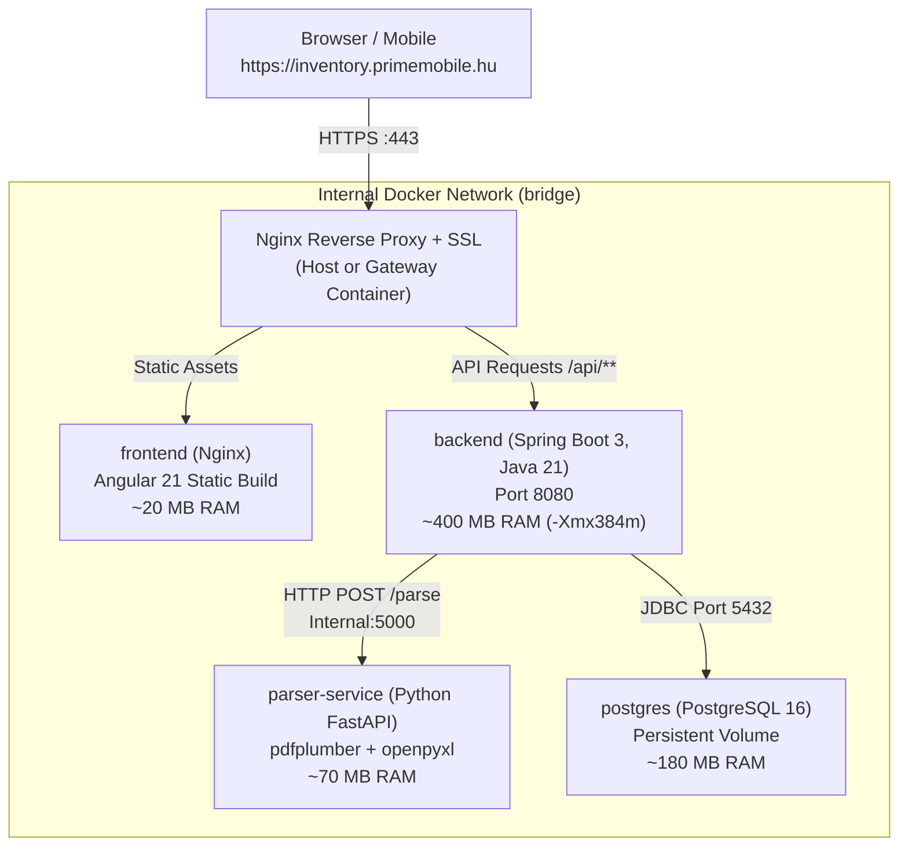

# Architecture Decision Record (ADR): Dockerized Cloud Architecture

## 1. Context & Motivation
- **Target Domain**: `inventory.primemobile.hu` (Subdomain under `primemobile.hu`)
- **Host**: Debian 13 VPS, 2 GB RAM, 1-2 vCPU.
- **Decision**: 
  - **Dockerized Multi-Container Setup**: Everything runs in isolated containers connected through an internal Docker bridge network.
  - **Keep the Battle-Tested Python Parser**: The existing Python parser (`pdf_parser.py` using `pdfplumber` + regex) is retained as a dedicated, lightweight microservice (`parser-service`). It already handles Számlázz.hu edge cases, multi-page NMHH wipe code stitching, and courier filtering flawlessly.
  - **Spring Boot Core API**: Spring Boot 3 (Java 21) handles business logic (Stock receiving, POS sales, P&L calculations, audit logging, Spring Security + JWT authentication) and PostgreSQL persistence.
  - **Inter-service Communication**: Spring Boot receives invoice uploads from the frontend and calls the internal Python parser service (`http://parser-service:5000/parse`) over Docker's internal network.

---

## 2. Docker Architecture & Resource Budgeting (2 GB RAM VPS)

### Memory Footprint Breakdown on 2 GB RAM:
| Service | Technology | Approx. RAM | Purpose |
|---|---|---|---|
| **Debian 13 Host** | Linux Kernel + systemd | ~250 MB | Host OS & Docker Daemon |
| **postgres** | PostgreSQL 16 Alpine | ~180 MB | Relational database with volume mount |
| **backend** | Spring Boot 3 (Java 21) | ~400 MB | Business domain, Spring Data JPA, Spring Security |
| **parser-service** | Python 3.12 (FastAPI / pdfplumber) | ~70 MB | PDF extraction & future Excel scrapers |
| **frontend** | Nginx Alpine | ~20 MB | Serves pre-built Angular 21 static files |
| **Total Usage** | | **~920 MB** | **Leaves > 1 GB free RAM buffer!** |

---

## 3. Why This Approach is Superior

1. **Zero Reinventing the Wheel**:
   - Számlázz.hu invoices have intricate formatting quirks (floating totals, cross-page NMHH data wipe codes, multi-line product descriptions).
   - The Python `pdf_parser.py` already solves 100% of these edge cases with tested regular expressions. Rewriting this in Java/PDFBox from scratch would introduce regressions.
2. **Easy Extensibility for Excel**:
   - Python's ecosystem (`openpyxl`, `pandas`) allows adding Excel price list or supplier catalog parsing in minutes within `parser-service`.
3. **Ideal for Java Developer Growth**:
   - Spring Boot acts as the **central orchestrator / domain service**, communicating with external REST services (`RestClient` / `WebClient`), managing PostgreSQL transactions, Flyway migrations, and Spring Security. This is a very common enterprise architecture pattern.
4. **Keycloak Evaluation**:
   - **Keycloak is omitted** because running it alongside this stack would exceed the 2 GB VPS limit and trigger the Linux OOM killer. Native Spring Security 6 with JWT handles authentication cleanly in ~15 MB RAM.
