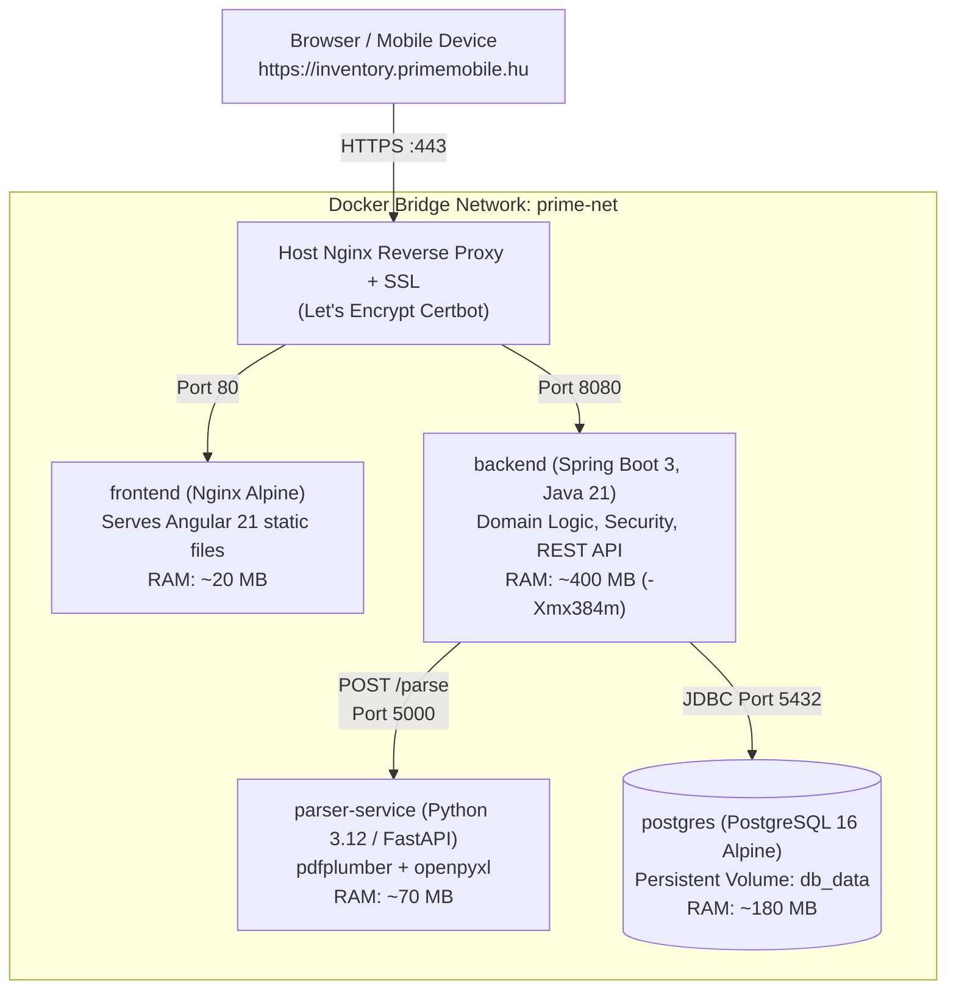

# System Architecture & Technical Specification: Prime Mobile Készlet- és Számlanyilvántartó

## 1. Executive Summary & Objective

**Prime Mobile Készlet- és Számlanyilvántartó** is a dockerized web platform designed for retail store inventory management, procurement tracking, and profit analysis.

### Core Business Flow (3-Stage Store Retail Lifecycle):
1. **Invoice Upload**: Clerk uploads a procurement invoice (Számlázz.hu PDF, or future Excel supplier price lists/catalogs).
2. **Automated Parsing & Ingestion (Stage 1: Számla beérkezett)**:
   - Spring Boot passes the file to the internal Python `parser-service` over the local Docker network.
   - The parser extracts supplier details, line items, quantities, and NMHH data wipe codes (`adattörlő kódok`), automatically filtering out courier/shipping fees.
   - Items are stored in PostgreSQL under `ORDERED` status (awaiting physical package arrival).
3. **Physical Goods Receipt (Stage 2: Raktárra beérkezett)**:
   - When the shipment arrives at the shop, the clerk inspects the package, verifies the device wipe codes, and clicks **"Átvétel raktárra"**.
   - The items enter the active physical store inventory (`current_quantity`).
4. **Point of Sale & Profit Tracking (Stage 3: Eladva & Haszon)**:
   - From the **"Raktárkészlet & Eladás"** screen, the clerk records the retail sale by entering the actual sale price (HUF gross) and buyer details.
   - The system calculates realized profit and gross margin in real time:
     $$\text{Profit} = \text{Sale Price} - (\text{Purchase Unit Cost Gross} \times \text{Quantity})$$
   - Storno/rollback capability restores the item to active stock if an error occurs.
5. **Real-time Analytics**: The **"Haszon Kimutatás"** dashboard tracks total turnover, cost of goods sold (COGS), gross margin (HUF and %), and units sold.
6. **Audit Trail**: Every movement is recorded in `transaction_logs`.

---

## 2. Infrastructure & Docker Deployment (2 GB RAM VPS)

### 2.1. Target Server:
- **Host**: Debian 13 GNU/Linux VPS (2 GB RAM, 1-2 vCPU, SSD storage).
- **Public Domain**: `https://inventory.primemobile.hu` (Subdomain of `primemobile.hu`).
- **SSL Termination**: Nginx on the host (or ingress container) with Let's Encrypt Certbot.

### 2.2. Service Topology (Local Docker Bridge Network):
All services run inside Docker containers orchestrated by `docker-compose.yml`:



### 2.3. Memory Allocation (Budgeted for 2 GB VPS):
| Service | Image / Base | RAM Limit / Target | Description |
|---|---|---|---|
| **Host OS** | Debian 13 | ~250 MB | Systemd, kernel, Docker daemon |
| **postgres** | `postgres:16-alpine` | ~180 MB | Relational database (`shared_buffers=128MB`) |
| **backend** | `eclipse-temurin:21-jre-alpine` | ~400 MB | Spring Boot 3 (`-Xms256m -Xmx384m -XX:+UseG1GC`) |
| **parser-service** | `python:3.12-slim` | ~70 MB | FastAPI microservice wrapping `pdf_parser.py` |
| **frontend** | `nginx:alpine` | ~20 MB | Pre-built Angular static files |
| **Free / Buffer** | | **> 1,000 MB** | Safe buffer for system caches & peak traffic |

> [!NOTE]
> **Why No Keycloak?** Keycloak requires 700 MB – 1.2 GB of RAM on its own. Running it on a 2 GB VPS alongside PostgreSQL, Spring Boot, Python, and Nginx would trigger the Linux OOM Killer. Native Spring Security 6 with stateless JWT uses only ~15–25 MB of RAM and is the ideal real-world implementation for Java developers.

---

## 3. Project Directory Structure

```
nyilvantarto/
 ├── docker-compose.yml              # Local & production multi-container orchestration
 ├── docker-compose.prod.yml         # Production overrides (domain, SSL mounts)
 ├── gemini.md                       # This technical specification
 ├── ARCHITECTURE.md                 # Architecture Decision Record
 │
 ├── backend/                        # Spring Boot 3 Application (Java 21, Maven)
 │    ├── pom.xml
 │    ├── Dockerfile                 # Multi-stage Docker build (Maven package -> Temurin JRE)
 │    └── src/main/
 │         ├── java/hu/primemobile/inventory/
 │         │    ├── config/          # SecurityConfig, WebMvcConfig, RestClientConfig
 │         │    ├── security/        # JwtService, JwtFilter, UserDetailsServiceImpl
 │         │    ├── domain/          # Entities: Supplier, Invoice, InventoryItem, Sale, TransactionLog, AppUser
 │         │    ├── repository/      # Spring Data JPA Repositories
 │         │    ├── service/         # ReceivingService, StockService, SalesService, ParserClientService
 │         │    ├── web/             # REST Controllers & DTO records
 │         │    └── PrimeInventoryApplication.java
 │         └── resources/
 │              ├── application.yml
 │              ├── application-prod.yml
 │              └── db/migration/    # Flyway SQL migrations (V1__init_schema.sql, V2__...)
 │
 ├── parser-service/                 # Dedicated Python Parsing Microservice
 │    ├── Dockerfile
 │    ├── requirements.txt           # fastapi, uvicorn, pdfplumber, openpyxl
 │    ├── main.py                    # Lightweight FastAPI wrapper: POST /parse/pdf, POST /parse/excel
 │    ├── pdf_parser.py              # Proven Számlázz.hu regex parser & NMHH extractor
 │    └── excel_parser.py            # Future Excel/CSV price list parser
 │
 ├── frontend/                       # Angular 21 Standalone Application
 │    ├── Dockerfile                 # Multi-stage build (Node build -> Nginx static serving)
 │    ├── nginx.conf                 # Internal Nginx router (SPA fallback, caching, gzip)
 │    ├── package.json
 │    └── src/                       # Angular source (dedicated .ts, .html, .scss per component)
 │
 └── data/
      ├── postgres/                  # Persisted PostgreSQL data volume
      └── uploaded_pdfs/             # Archive of uploaded invoice files
```

---

## 4. Parser Service Specification (`parser-service`)

The Python parsing service is retained as an independent, stateless microservice listening on internal port `5000`:

### Endpoints:
1. `POST /parse/pdf`:
   - Input: Multipart form file (`file: UploadFile`).
   - Action: Executes `pdf_parser.py` (text regex extraction, cross-page NMHH wipe code capture, service filtering).
   - Output: JSON conforming to `ParsedInvoiceResult`:
     ```json
     {
       "supplier": {
         "name": "PLANET MOBILE Kft.",
         "tax_number": "26189967-2-08",
         "eu_tax_number": "HU26189967",
         "address": "9094 Tápszentmiklós, Fő u 38",
         "bank_account": "11731001-23140389"
       },
       "invoice": {
         "invoice_number": "PMGYT-2026-246",
         "issue_date": "2026-10-20",
         "delivery_date": "2026-10-20",
         "due_date": "2026-10-20",
         "payment_method": "átutalás",
         "total_net_amount": 2527685,
         "total_vat_amount": 32315,
         "total_gross_amount": 2560000
       },
       "items": [
         {
           "line_index": 1,
           "product_name": "Samsung Galaxy S25",
           "raw_description": "Samsung Galaxy S25 128GB Fekete Kártyafüggetlen",
           "unit": "db",
           "initial_quantity": 2,
           "unit_price_net": 205000,
           "vat_rate": "K.AFA",
           "total_net": 410000,
           "total_vat": 0,
           "total_gross": 410000,
           "wipe_codes": ["A276-3NKT-99LI-LLS7", "A276-3NKT-99LI-LLS8"]
         }
       ],
       "filtered_services": ["Glscsomagküldés"]
     }
     ```
2. `POST /parse/excel`:
   - Input: Multipart spreadsheet file (`.xlsx`, `.csv`).
   - Action: Reads tabular product lists using `openpyxl`, mapping supplier SKU, product name, quantities, and wholesale prices.

---

## 5. PostgreSQL Database Schema

### Table Definitions:

```sql
-- 1. Authentication & Users
CREATE TABLE app_users (
    id BIGSERIAL PRIMARY KEY,
    username VARCHAR(50) UNIQUE NOT NULL,
    password_hash VARCHAR(255) NOT NULL,
    full_name VARCHAR(100) NOT NULL,
    role VARCHAR(20) NOT NULL DEFAULT 'ROLE_CLERK', -- ROLE_ADMIN, ROLE_CLERK
    active BOOLEAN NOT NULL DEFAULT TRUE,
    created_at TIMESTAMPTZ NOT NULL DEFAULT NOW()
);

-- 2. Suppliers
CREATE TABLE suppliers (
    id BIGSERIAL PRIMARY KEY,
    name VARCHAR(255) NOT NULL,
    tax_number VARCHAR(50) UNIQUE NOT NULL,
    eu_tax_number VARCHAR(50),
    address VARCHAR(500),
    bank_account VARCHAR(100),
    created_at TIMESTAMPTZ NOT NULL DEFAULT NOW()
);

-- 3. Invoices
CREATE TABLE invoices (
    id BIGSERIAL PRIMARY KEY,
    supplier_id BIGINT NOT NULL REFERENCES suppliers(id) ON DELETE RESTRICT,
    invoice_number VARCHAR(100) UNIQUE NOT NULL,
    issue_date DATE,
    delivery_date DATE,
    due_date DATE,
    payment_method VARCHAR(50),
    total_net_amount BIGINT,
    total_vat_amount BIGINT,
    total_gross_amount BIGINT,
    pdf_filename VARCHAR(255) NOT NULL,
    status VARCHAR(30) NOT NULL DEFAULT 'ACTIVE', -- ACTIVE, COMPLETED
    uploaded_at TIMESTAMPTZ NOT NULL DEFAULT NOW()
);

-- 4. Inventory Items (with 3-Stage retail states)
CREATE TABLE inventory_items (
    id BIGSERIAL PRIMARY KEY,
    invoice_id BIGINT NOT NULL REFERENCES invoices(id) ON DELETE CASCADE,
    supplier_id BIGINT NOT NULL REFERENCES suppliers(id) ON DELETE RESTRICT,
    line_index INT NOT NULL,
    product_name VARCHAR(255) NOT NULL,
    raw_description TEXT,
    data_wipe_codes JSONB DEFAULT '[]'::jsonb,
    unit VARCHAR(20) NOT NULL DEFAULT 'db',
    initial_quantity INT NOT NULL,
    received_quantity INT NOT NULL DEFAULT 0,
    sold_quantity INT NOT NULL DEFAULT 0,
    current_quantity INT NOT NULL DEFAULT 0, -- Active physical store inventory
    unit_price_net BIGINT NOT NULL,
    unit_price_gross BIGINT NOT NULL,
    vat_rate VARCHAR(20) NOT NULL,
    total_net BIGINT NOT NULL,
    total_vat BIGINT NOT NULL,
    total_gross BIGINT NOT NULL,
    status VARCHAR(30) NOT NULL DEFAULT 'ORDERED', -- ORDERED, PARTIAL, RECEIVED
    received_at TIMESTAMPTZ,
    is_fully_deducted BOOLEAN NOT NULL DEFAULT FALSE
);

-- 5. Sales (Retail POS & Margin Realization)
CREATE TABLE sales (
    id BIGSERIAL PRIMARY KEY,
    inventory_item_id BIGINT NOT NULL REFERENCES inventory_items(id) ON DELETE CASCADE,
    invoice_id BIGINT NOT NULL REFERENCES invoices(id) ON DELETE CASCADE,
    supplier_id BIGINT NOT NULL REFERENCES suppliers(id) ON DELETE RESTRICT,
    sold_by_user_id BIGINT REFERENCES app_users(id),
    quantity INT NOT NULL DEFAULT 1,
    unit_cost_net BIGINT NOT NULL,
    unit_cost_gross BIGINT NOT NULL,
    sale_price BIGINT NOT NULL, -- Total gross retail price (HUF)
    profit BIGINT NOT NULL, -- sale_price - (unit_cost_gross * quantity)
    used_wipe_code VARCHAR(100),
    customer_name VARCHAR(255),
    note TEXT,
    sold_at TIMESTAMPTZ NOT NULL DEFAULT NOW(),
    created_at TIMESTAMPTZ NOT NULL DEFAULT NOW()
);

-- 6. Audit Trail
CREATE TABLE transaction_logs (
    id BIGSERIAL PRIMARY KEY,
    inventory_item_id BIGINT NOT NULL REFERENCES inventory_items(id) ON DELETE CASCADE,
    invoice_id BIGINT NOT NULL REFERENCES invoices(id) ON DELETE CASCADE,
    supplier_id BIGINT NOT NULL REFERENCES suppliers(id) ON DELETE RESTRICT,
    user_id BIGINT REFERENCES app_users(id),
    action_type VARCHAR(30) NOT NULL, -- INITIAL_IMPORT, STOCK_RECEIVE, STOCK_RECEIVE_CANCEL, SALE, SALE_CANCEL
    quantity_changed INT NOT NULL,
    quantity_before INT NOT NULL,
    quantity_after INT NOT NULL,
    used_wipe_code VARCHAR(100),
    note TEXT,
    created_at TIMESTAMPTZ NOT NULL DEFAULT NOW()
);

-- Performance Indexes
CREATE INDEX idx_items_supplier ON inventory_items(supplier_id);
CREATE INDEX idx_items_invoice ON inventory_items(invoice_id);
CREATE INDEX idx_items_status ON inventory_items(status);
CREATE INDEX idx_sales_date ON sales(sold_at);
CREATE INDEX idx_logs_created ON transaction_logs(created_at);
```

---

## 6. Spring Boot 3 Backend Architecture

### 6.1. Technology Choices:
- **Framework**: Spring Boot 3.4.x with Java 21 LTS.
- **Data Access**: Spring Data JPA + Hibernate 6.
- **Migration**: Flyway (`db/migration/V1__init_schema.sql`).
- **HTTP Client**: Spring 6 `RestClient` for synchronous, low-overhead calls to `http://parser-service:5000`.
- **Security**: Spring Security 6 with stateless JWT Bearer token authentication and BCrypt password encryption.

### 6.2. REST Endpoints (Matching Frontend):
- `POST /api/v1/auth/login`: Authenticate clerk/admin, return JWT token.
- `GET /api/v1/auth/me`: Current user profile and roles.
- `POST /api/v1/invoices/upload`: Accepts PDF/Excel file, calls `parser-service`, saves invoice & items, creates audit log.
- `GET /api/v1/invoices`: List invoice summaries with filters (`supplier_id`, `status`, `search`).
- `GET /api/v1/suppliers`: List vendors with stock summaries.
- `GET /api/v1/receiving`: List items for goods check-in (`status=PENDING` or `ALL`).
- `POST /api/v1/receiving/{itemId}/receive`: Check in items to physical store stock.
- `POST /api/v1/receiving/{itemId}/cancel`: Undo receipt.
- `GET /api/v1/stock`: Active in-store inventory (`current_quantity > 0`).
- `POST /api/v1/stock/{itemId}/sell`: Record sale price, customer, calculate profit.
- `GET /api/v1/sales`: Sales & P&L analytics report (`date_from`, `date_to`, `supplier_id`).
- `POST /api/v1/sales/{saleId}/cancel`: Storno sale, restores item to store stock.
- `GET /api/v1/logs`: Filterable audit trail.

---

## 7. Production Deployment Guide (`inventory.primemobile.hu`)

### 7.1. Host Nginx Configuration (`/etc/nginx/sites-available/inventory.primemobile.hu`):
```nginx
server {
    server_name inventory.primemobile.hu;

    client_max_body_size 25M;

    # SSL is automatically injected by certbot:
    # certbot --nginx -d inventory.primemobile.hu

    location / {
        proxy_pass http://127.0.0.1:80; # Frontend container
        proxy_set_header Host $host;
        proxy_set_header X-Real-IP $remote_addr;
        proxy_set_header X-Forwarded-For $proxy_add_x_forwarded_for;
        proxy_set_header X-Forwarded-Proto $scheme;
    }

    location /api/ {
        proxy_pass http://127.0.0.1:8080/api/; # Spring Boot backend container
        proxy_set_header Host $host;
        proxy_set_header X-Real-IP $remote_addr;
        proxy_set_header X-Forwarded-For $proxy_add_x_forwarded_for;
        proxy_set_header X-Forwarded-Proto $scheme;
    }
}
```

### 7.2. Production `docker-compose.yml`:
```yaml
version: '3.8'

services:
  postgres:
    image: postgres:16-alpine
    container_name: prime-postgres
    restart: unless-stopped
    environment:
      POSTGRES_DB: prime_inventory
      POSTGRES_USER: prime_user
      POSTGRES_PASSWORD: ${DB_PASSWORD}
    volumes:
      - db_data:/var/lib/postgresql/data
    networks:
      - prime-net
    healthcheck:
      test: ["CMD-SHELL", "pg_isready -U prime_user -d prime_inventory"]
      interval: 5s
      timeout: 5s
      retries: 5

  parser-service:
    build:
      context: ./parser-service
    container_name: prime-parser
    restart: unless-stopped
    networks:
      - prime-net

  backend:
    build:
      context: ./backend
    container_name: prime-backend
    restart: unless-stopped
    depends_on:
      postgres:
        condition: service_healthy
      parser-service:
        condition: service_started
    environment:
      SPRING_PROFILES_ACTIVE: prod
      SPRING_DATASOURCE_URL: jdbc:postgresql://postgres:5432/prime_inventory
      SPRING_DATASOURCE_USERNAME: prime_user
      SPRING_DATASOURCE_PASSWORD: ${DB_PASSWORD}
      PARSER_SERVICE_URL: http://parser-service:5000
      JWT_SECRET: ${JWT_SECRET}
    ports:
      - "127.0.0.1:8080:8080"
    volumes:
      - invoice_storage:/app/data/invoices
    networks:
      - prime-net

  frontend:
    build:
      context: ./frontend
    container_name: prime-frontend
    restart: unless-stopped
    ports:
      - "127.0.0.1:80:80"
    networks:
      - prime-net

networks:
  prime-net:
    driver: bridge

volumes:
  db_data:
  invoice_storage:
```

---

## 8. Implementation Steps & Roadmap

1. **Parser Service Containerization**:
   - Wrap the existing, working `pdf_parser.py` into a lightweight FastAPI service inside `parser-service/`.
   - Add Dockerfile and requirements.
2. **Spring Boot Backend Project Generation**:
   - Set up Spring Boot 3.4 (Java 21) in `backend/` with Maven (`pom.xml`).
   - Add dependencies: `spring-boot-starter-web`, `spring-boot-starter-data-jpa`, `spring-boot-starter-security`, `flyway-core`, `flyway-database-postgresql`, `postgresql`, `jjwt`.
   - Add Flyway `V1__init_schema.sql` migration.
   - Implement `ParserClient` calling `http://parser-service:5000/parse/pdf`.
   - Implement domain entities, repositories, and business services.
   - Implement REST controllers matching Angular's API routes.
3. **Frontend Dockerization**:
   - Create Angular multi-stage `Dockerfile` (Node build &rarr; Nginx alpine).
4. **End-to-End Local Verification with Docker Compose**:
   - Run `docker compose up --build`.
   - Verify upload of sample invoice `PMGYT-2026-246_sample.pdf` &rarr; parser &rarr; Spring Boot &rarr; PostgreSQL &rarr; Angular UI.
5. **VPS Deployment Script**:
   - Create automated Debian 13 script to install Docker, configure host Nginx, obtain Let's Encrypt SSL for `inventory.primemobile.hu`, and start the containers.
